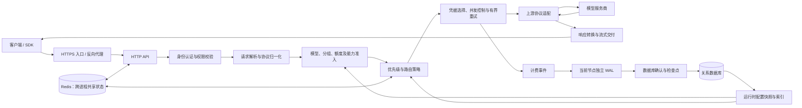
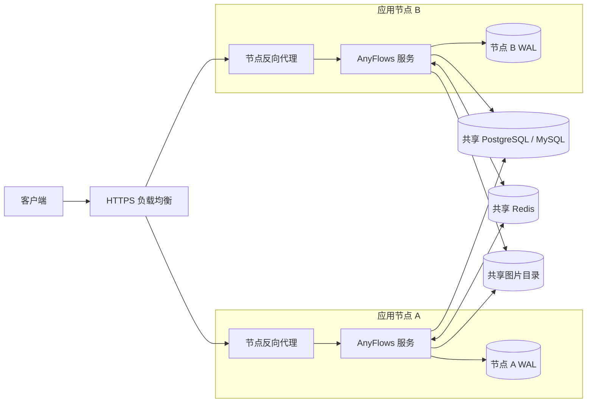

# AnyFlows 系统能力与架构说明

本文概述 AnyFlows 的请求处理、路由、计费和部署机制，供技术选型、部署评估与系统维护参考。内容以当前仓库实现和配套文档为依据；具体配置步骤及完整行为约束请以各专题文档为准。

功能状态以各节标记为准；尚未发布的改动不应视为当前发行版已提供的能力。部署时请核对所用版本的[变更记录](../CHANGELOG.md)及[发行说明](https://github.com/ChuqiCloud/AnyFlows/releases)。

## 请求处理架构

下图概括普通模型请求的主要路径及运行时状态的用途。实际请求会按端点和渠道能力选择相应适配器；并非每种协议组合都支持相同的操作和内容类型。

图中数据库和 Redis 承担不同职责：关系数据库保存业务数据；Redis 用于需要跨进程协调的运行状态。计费 WAL 是每个服务实例自己的恢复日志，不是共享数据库或备份的替代品。

多节点部署时，请求层按节点横向扩展；共享数据库、Redis 和图片存储，计费 WAL 则留在各自节点：

SQLite 适用于单节点。多节点要求所有服务节点共享同一 PostgreSQL 或 MySQL 和 Redis 实例；每个节点的 WAL 目录必须独立且持久化。

| 部署模式 | 关系数据库 | Redis | 计费 WAL | 图片文件 |
| --- | --- | --- | --- | --- |
| 单节点 | SQLite、PostgreSQL 或 MySQL | 按需配置 | 当前实例本地持久目录 | 本地持久目录 |
| 多节点 | 共享 PostgreSQL 或 MySQL | 所有节点共用同一实例/逻辑库 | 每个节点独立目录，不共享 | 所有节点挂载同一读写目录 |

## 协议入口与上游适配

服务提供 OpenAI Chat、OpenAI Responses、Anthropic Messages 和 Gemini GenerateContent 四类请求入口，并可适配至相应的上游协议。协议文档列出 16 个入口与上游方向；每个方向的具体能力受目标协议、模型和操作类型约束。

同协议转发保留该协议可传递的字段。跨协议路径将消息、工具调用、采样参数和用量转换为目标协议能够表达的形式；无法安全映射的服务端会话状态或不透明媒体语义会返回兼容性错误。Responses 会话依赖客户端回传完整历史，不支持引用上游保存的 `previous_response_id` 或 `conversation` 状态。

支持普通及流式对话处理，并按适配器能力覆盖图像、音频、视频、嵌入和重排序等操作。某项操作是否可用还取决于渠道能力、凭据模型权限和具体上游模型。

**实现与说明：** [对话协议兼容](conversation-compatibility.md)、[协议适配器](../crates/af-adapter/src/lib.rs)。

## 路由与故障处理

路由先按用户和 API Key 的权限、分组、模型能力、凭据状态及并发约束确定可执行候选，再应用优先级、权重和路由策略。可用的策略包括价格优先、稳定优先、固定顺序、轮询和加权。失败重试遵循有界请求计划，不重复尝试同一目标。

个人智能路由组属于用户资源，成员只能从该用户有权使用的分组中选择。价格优先在请求规划时固定有效价卡和额度预留；实际执行目标用于费用和调用记录。流式响应已经交付后不切换上游重放；异步任务一经受理便固定执行目标。

健康状态按渠道、凭据和模型维度归属。模型能力错误和模型级限流不会扩大为账号整体故障；认证状态可按共享凭据身份关联。多节点部署可通过 Redis 共用运行状态。健康信号只能调整合法候选的顺序或权重，不能覆盖授权、停用、额度和能力限制。

### 渠道质量评分与上游价值路由

**状态：** 已实现并通过对应回归，尚未随发行版发布。

该改动在现有失败惩罚和熔断机制上增加近期成功/失败样本、成功延迟 EMA、模型级健康隔离及瞬时失败的 Fibonacci 软避让。软避让优先选择同层其他候选；整层均处于软避让时仍保留降权后的尝试机会。硬熔断、禁用和权限过滤仍先行生效。

加权策略可选用管理员维护的上游成本、可用余额和观测用量信号。信号只有在同组、同模型、同优先级且单位或时间窗口可比时才参与比较；缺失、不可比或样本不足时保持中性。该配置不读取用户钱包或平台销售价，也不会改写业务价卡与计费。

运行时健康统计依赖 Redis。上游价值快照由管理员更新，目前没有自动采集或过期机制；数据无法确认仍然有效时应移除。算法参数、设置格式与边界见[渠道评分专题](channel-routing.md)。

## 凭据与自动化接口

模型 Key 用于模型 API 请求；系统 API 个人访问令牌（PAT）用于获授权的业务和管理 API。两种凭据有独立的权限与生命周期。普通用户的 PAT 仅能操作本人获准资源；管理员 PAT 可在签发时选择已登记的管理操作权限，但请求仍检查当前管理员角色和业务规则。

PAT 只能通过 Bearer 请求头传递，创建时明文仅展示一次，支持有效期、IP/CIDR 限制、审计和撤销。PAT 的签发、权限变更及撤销本身需要交互会话；敏感凭据操作还可能要求近期认证。PAT 获准管理模型 Key 时，所创建的模型 Key 独立生效，撤销 PAT 不会自动撤销该 Key。

**实现与说明：** [系统 API Token](personal-access-tokens.md)、[认证与访问控制](authentication-and-access.md)。

## 用量、费用与诊断

调用记录包含请求结果、用量、费用和实际路由目标。上游未提供可用用量时，系统可能采用估算值；报表应区分上游确认与估算数据。管理员可以使用请求关联信息和脱敏诊断数据排查协议转换、选路与上游错误。

计费增量先写入当前实例独占的 WAL，再由数据库 sink 确认。实例重启后可恢复尚未确认的事件；多节点需分别保留每个节点的 WAL。WAL 不替代关系数据库备份，亦不能据此推断任意磁盘或数据库故障下的数据保证。

「运行状态」页面展示节点、数据库、Redis 及近期资源趋势。资源趋势保存在进程内存，重启后清空；长期保留、告警和历史分析需接入独立监控系统。

**实现与说明：** [运行状态与统计口径](runtime-status.md)、[请求诊断](channels.md#请求诊断)、[备份与恢复](migrations-and-release.md)、[计费 WAL](../crates/af-server/src/billing_runtime.rs)。

## 商户供给与审核

商户可录入服务和模型信息、保存草稿并提交审核。草稿与已生效版本分离；平台侧完成所需模型及价卡校验并批准后，供给才可进入正式路由。提交审核不等于发布，也不代表模型已获准调度。价格变更、暂停及恢复还受服务状态与定价规则约束。

**实现与说明：** [商户供给接口](../crates/af-http/src/merchant_pool.rs)、[商户供给仓储](../crates/af-db/src/merchant_pool.rs)、[发行变更记录](../CHANGELOG.md)。

## 部署、扩展与升级

单节点可使用 SQLite、PostgreSQL 或 MySQL。多节点部署使用共享 PostgreSQL 或 MySQL 及共享 Redis；所有节点应运行一致版本并配置相同的会话签名和凭据加密密钥。每个实例保留独立 WAL；生图文件需使用各节点均可访问的共享目录。SQLite 数据库文件不适用于多节点共享部署。

公开发行包面向 Linux、Windows 和 macOS 的 amd64、arm64 平台，包含服务程序、启动器和内置 Next 控制台，运行时无需安装 Rust 或 Node.js。更新作用于当前节点；多节点需按节点部署。程序回退不会自动回滚数据库迁移，升级前应备份数据库、配置和 WAL。

Next 控制台可替换为符合接口契约的静态模板，也可通过源码扩展增加路由和页面。扩展复用宿主的会话、API 客户端、权限能力目录和翻译资源；导航可见不替代后端鉴权。外部模板和多节点上的模板文件需与部署版本保持兼容。

**实现与说明：** [多节点部署](multi-node-deployment.md)、[配置参考](configuration.md)、[部署与配置](deployment-and-configuration.md)、[在线更新](online-updates.md)、[前端模板与扩展](frontend-template-development.md)。

### 跨语言插件与集群分发

**状态：** 本分支新增能力，尚未随发行版发布。

插件以独立进程运行，通过版本化 JSON Lines 契约与宿主交互，可使用 Python、Go、Rust 等语言实现，无需依赖 Rust 动态库 ABI。常规安装只需上传插件包；自有插件无需签名，也不要求额外部署制品服务。官方来源标识单独验证已配置的官方公钥，不影响管理员安装自己的插件。

共享数据库保存完整归档和部署历史，各节点自动恢复缺失或损坏的缓存。控制台按节点租约、部署代次、包摘要和实际健康状态统计就绪数量，区分管理员期望与进程实际状态。停用保留恢复条件；卸载传播逐节点清理意图；撤销后的制品可显式回收归档，保留审计和历史记录。使用同一部署的节点仍须具备兼容的操作系统、架构和运行依赖。

用户模型页已接入固定的只读目录能力，宿主负责认证、能力授权、数据投影、分页和调用限额。目录插件提供模型资料，不能直接创建渠道、价卡或钱包余额。身份、授权、账本、结算与数据库迁移由宿主持有；声明能力不等于取得这些操作权限。

Linux 可按部署需要选择资源限制或文件系统、网络命名空间隔离；Windows 使用 Job Object 管理进程树。控制台显示实际采用的隔离等级，强制沙箱策略缺少系统能力时启动失败。Python SDK、完整目录示例和开发文档为跨语言实现提供可复用入口。

**实现与说明：** [插件安装与 Sidecar 协议](plugin-sidecars.md)、[插件开发与运行隔离](plugin-development.md)、[插件契约](../crates/af-plugin-contract/src/lib.rs)。

## 文档维护规则

新增项目能力时，在本文对应章节更新；若现有分类不适用，再新增章节。总览保持简明，将参数、接口流程和操作步骤放入专题文档。每个重要主张应链接到实现或专题文档，并明确功能状态与运行前置条件。

- 区分已发布、开发中和已实现未发布能力；只将对应状态写入适用版本说明。
- 只记录能够从当前实现、正式文档或可重复验证中确认的行为。推断、计划和外部项目能力不得写成 AnyFlows 现状。
- 性能、容量和可用性结论必须提供测量环境、负载、方法和结果来源；没有数据时不提供数值承诺。
- 当权限、计费、兼容性或部署要求发生变化时，同步修订本页及相关专题文档。
- 对 Mermaid 架构图同步维护节点名称和边界，不添加当前实现不存在的服务或链路。
